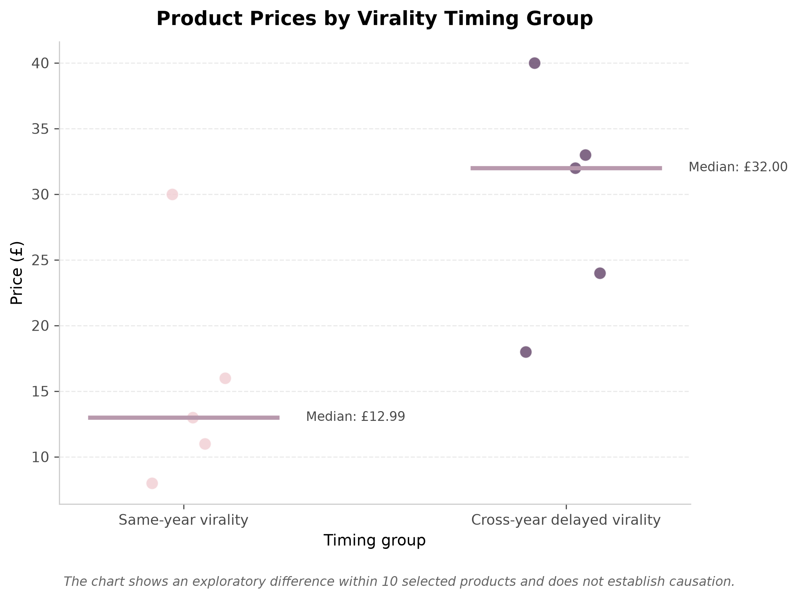
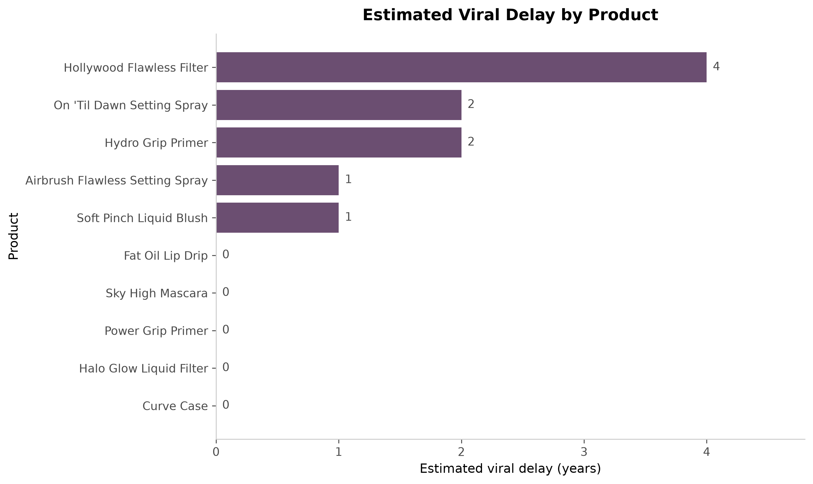
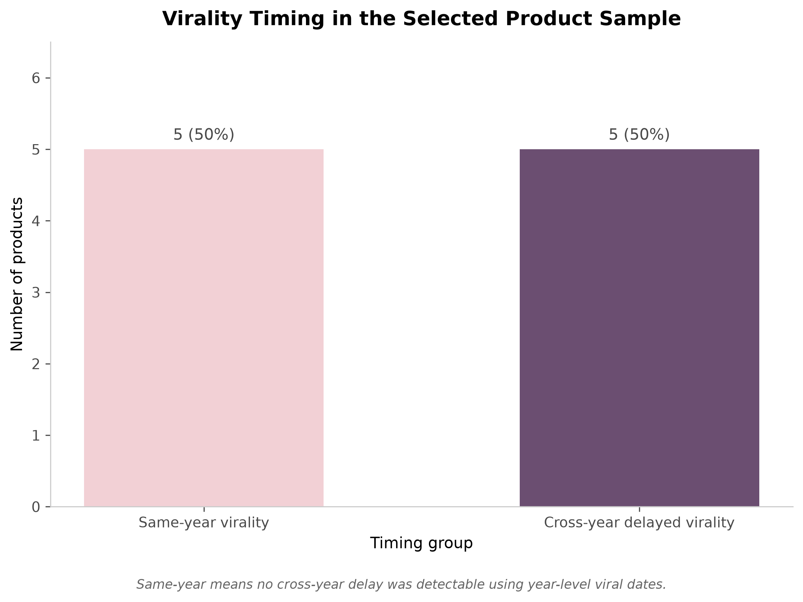

# Beauty Product Virality Analysis 

## Research Question 

Did social media affect the virality of once unknown beauty products?

## Aim 

The aim of the project was to investigate the association between product virality and social media activity. This was measured by looking into variables such as price and the way the products were promoted, in order to understand whether these factors also played a role in why some products became more viral than others.

## Dataset

The analysis used 10 beauty products. These products were deliberately selected to include variation in brands, prices and viral timing. The information collected for each product included the product name, brand, launch date, estimated date it became viral, price, social media platform, how it was promoted, the campaign type (such as paid, affiliate organic or mixed), and the observed outcome.

## Methodology 

The data was collected by researching each product using the internet. The information collected for each product was the date it was launched, a rough estimation of when it became viral, price, how it was promoted, whether it was paid or organic, and so on. The information was then split into a product information table, which consisted of information about the product, such as price, launch date, etc. I then created a marketing information table that contained details of the promotion type, what platform it became viral on, etc. I then began cleaning the data so that everything ran seamlessly, such as removing '£' and making sure that 'TikTok' was written correctly so that Python could treat them as the same category. After this, the tables were merged so that all the information could be combined in one place, making it easier to understand. I then calculated the viral delay by subtracting the launch year from the estimated viral year. This allowed me to see how many calendar years apart the product launch and estimated viral year were. A viral delay of 0 meant the product became viral in the same calendar year it was launched, while a positive number meant it became viral in a later calendar year. The products were then grouped based on their viral timing into two categories: same-year virality and cross-year delayed virality. This allowed me to compare the products that became viral in the same year they were launched with those that became viral in a later year. I then compared the prices between the two groups using the mean and median. Finally, I analysed the social media activity surrounding each product by looking at the platform it became viral on, how it was promoted and whether the campaign was categorised as organic, paid, affiliate or mixed. I then used these findings to create three visualisations to make the patterns in the data easier to identify and compare.

## Key Findings 

The chart above compares products that went viral in the same year with products that experienced cross-year delayed virality. It shows that products with cross-year delayed virality had a higher median price of £32.00, whereas products that went viral in the same year had a median price of £12.99. This suggests that there is an association between the price of a product and the timing of its virality, with lower-priced products in this sample tending to go viral sooner.
 

 The chart above shows the estimated viral delay of each product in years. It shows that Hollywood Flawless Filter had the highest estimated viral delay of 4 years, whereas products such as Fat Oil Lip Drip and Sky High Mascara had no delay and went viral within the same year. The products that experienced a delay, whether small or large, also had higher prices. Therefore, within this sample, there appears to be an association between how long products took to become viral and their price.

The chart above compares products that became viral within the same year with products that experienced delayed virality. The graph shows an even split between the products in the two categories, In addition,the products that became viral within the same year also happened to have a lower median price, although this is not shown in this graph. This suggest that within this sample there is an association between lower-priced products and becoming viral sooner compared to higher-priced products.

## Limitations 

One limitation of this analysis is that the sample size wasn’t large enough to generalise these findings to the wider beauty industry. For example, some of the findings show that 5/10 products became viral in the same year. However, due to the sample size, I cannot confidently generalise these findings to the wider beauty industry or conclude that social media was responsible for the same-year virality of these 5 products. In addition to this, I selected all of these 10 products knowing that they were already viral, which may introduce selection bias, whereas a more randomly selected sample would have been able to give us a better overview of whether social media is associated with the virality of once-unknown products.

Another limitation is that social media activity may be difficult to measure comprehensively. A lot of the information in this analysis is based on Google searches and reports. Therefore, not having access to actual data from each company means I may not have captured the full extent of social-media activity surrounding each product, as there may have been paid promotions that I was not aware of that may have had an effect on the conclusion.

## Conclusion 

The aim of this project was to investigate the association between social media activity and the virality of once-unknown beauty products. The analysis found that 5/10 products became viral within the same calendar year, while the remaining 5/10 experienced virality in a later calendar year. In addition to this, the products that became viral within the same calendar year also had lower prices compared to the products that experienced cross-year delayed virality, which had higher prices. Therefore, in this sample, there appears to be an association between lower-priced products and the timing of their virality on social media, as the higher-priced products took longer to become viral.

Finally, a disclaimer that I think is important to add is that this analysis can identify associations but cannot establish causation. The limitations discussed above mean that the findings should be interpreted as patterns within this sample rather than proof that social media caused the products to become viral.